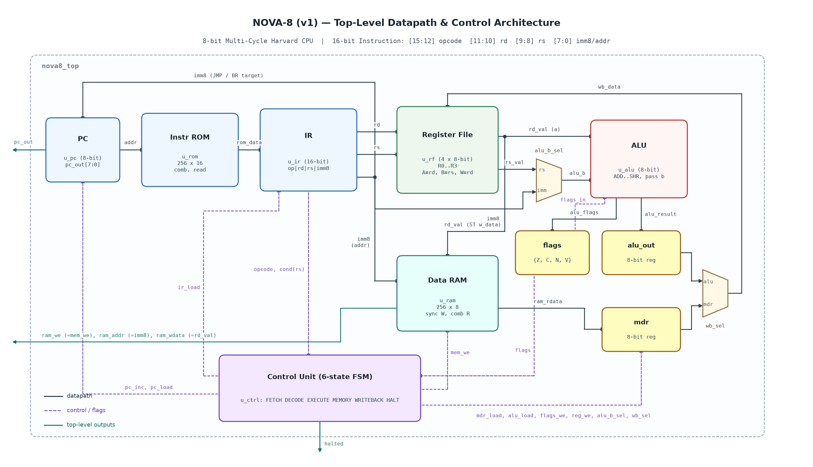
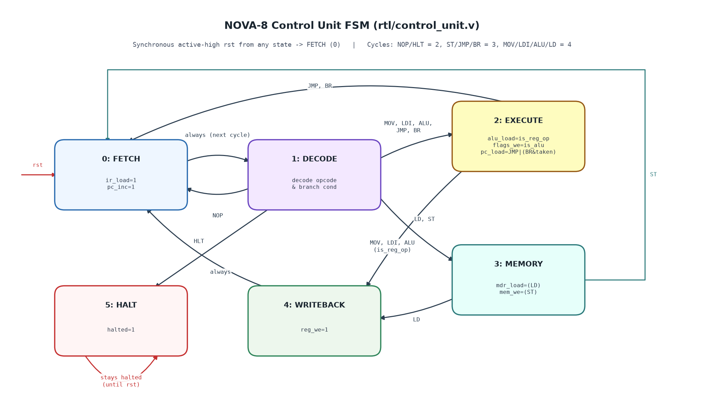
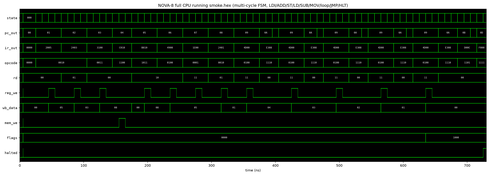

# NOVA-8

NOVA-8 is a small 8-bit CPU I wrote in Verilog-2001 as a student project. It is a
multi-cycle Harvard design: 16-bit instructions come from a read-only instruction
ROM, data lives in a separate 256-byte RAM, and a 6-state FSM steps each
instruction through fetch, decode, execute, memory and writeback. It only runs in
simulation (Icarus Verilog + GTKWave), and synthesis is checked with Yosys using its
generic gate library. A small Python assembler turns `.asm` files into hex files
for the ROM.

## Architecture (v1)

- 8-bit datapath, multi-cycle, Harvard (separate instruction ROM and data RAM)
- 4 general-purpose registers R0-R3
- 8-bit PC, 16-bit IR
- Instruction ROM: 256 x 16, loaded with `$readmemh` (default `programs/program.hex`)
- Data RAM: 256 x 8, synchronous write, combinational read
- Flags: Z, C, N, V (changed only by ALU instructions)
- FSM states: FETCH, DECODE, EXECUTE, MEMORY, WRITEBACK, HALT

Instruction format: `[15:12] opcode | [11:10] rd | [9:8] rs | [7:0] imm8/addr`

More detail is in the docs folder:
- [docs/architecture.md](docs/architecture.md): block diagram, FSM, control signals per
  state, cycles per instruction, known limits
- [docs/isa.md](docs/isa.md): full ISA table with encodings, branch conditions, flag
  rules, assembler syntax

Quick opcode list:

| Op | Instr | Op | Instr | Op | Instr | Op | Instr |
|----|-------|----|-------|----|-------|----|-------|
| 0 | `NOP` | 4 | `SUB rd, rs` | 8 | `NOT rd` | C | `ST rd, addr` |
| 1 | `MOV rd, rs` | 5 | `AND rd, rs` | 9 | `SHL rd` | D | `JMP addr` |
| 2 | `LDI rd, imm` | 6 | `OR rd, rs` | A | `SHR rd` | E | `BRZ/BRC/BRN/BRNZ addr` |
| 3 | `ADD rd, rs` | 7 | `XOR rd, rs` | B | `LD rd, addr` | F | `HLT` |

## Folder layout

| Path            | Contents |
|-----------------|----------|
| `rtl/`          | synthesizable Verilog, one module per file (`alu`, `reg_file`, `pc`, `ir`, `instr_rom`, `data_ram`, `control_unit`, `nova8_top`) |
| `tb/`           | self-checking testbenches `tb_<module>.v`, plus `tb_cpu_programs.v`, `tb_gls.v` (gate-level) and `rom_test.hex` |
| `programs/`     | test programs (`.asm`) and assembled `.hex` files; `program.hex` is what the ROM loads by default |
| `sim/`          | compiled sims (`.vvp`), VCD dumps, logs (`tb_<name>.log`) and gate netlists, not in git |
| `synth/`        | Yosys scripts `synth.ys` and `gls.ys`, raw reports and `report.md` |
| `docs/`         | architecture and ISA documentation |
| `results/`      | my own saved simulation logs, synthesis outputs and GTKWave screenshots |
| `assembler.py`  | the NOVA-8 assembler |
| `run.ps1`       | build script for Windows PowerShell |
| `Makefile`      | same targets for make |

## Tools

- Icarus Verilog (`iverilog`, `vvp`), used with `-g2012`
- GTKWave
- Yosys
- Python 3

On Windows:
- The Icarus Verilog installer from bleyer.org also installs GTKWave.
- Yosys comes with the OSS CAD Suite.
- Or install Yosys through pip: `pip install yowasp-yosys`, then tell the scripts to
  use it with `$env:YOSYS = "yowasp-yosys"` (run.ps1 reads `$env:YOSYS`, the Makefile
  takes `make report YOSYS=yowasp-yosys`). yowasp-yosys can only access files under
  the current directory, so run it from the project root.

The Makefile uses shell `for` loops, `cp` and `rm`, so on Windows it needs a make with
a Unix-style shell. Otherwise just use `run.ps1`.

## Running

Run everything from the project root. Each target works with either script:

    powershell -ExecutionPolicy Bypass -File run.ps1 <target> [module]
    make <target> M=<module>

| Target | What it does |
|--------|--------------|
| `sim <module>` | compile `tb/tb_<module>.v` and run it, log in `sim/tb_<module>.log` |
| `test` | run every testbench (except `tb_gls`), then print a PASS/FAIL summary |
| `gls [prog]` | gate-level simulation: synthesize a netlist per program and run `tb_gls.v` on it (all programs, or one: `run.ps1 gls fib` / `make gls P=fib`) |
| `wave <module>` | open `sim/tb_<module>.vcd` in GTKWave |
| `asm` | assemble every `programs/*.asm`, then copy `smoke.hex` to `program.hex`; stops at the first file with errors |
| `synth <module>` | quick Yosys synthesis + `stat` for one RTL module (testbench names are rejected) |
| `report` | full synthesis with `synth/synth.ys` |
| `clean` | delete compiled sims, VCDs, logs and gate netlists in `sim/` |

Unit tests (module names: `alu`, `reg_file`, `pc`, `ir`, `instr_rom`, `data_ram`,
`control_unit`):

    powershell -ExecutionPolicy Bypass -File run.ps1 sim alu
    make sim M=alu

Whole-CPU tests:

    # all seven test programs at the same time, plus countdown again with a
    # reset in the middle of the program (eight CPU instances)
    powershell -ExecutionPolicy Bypass -File run.ps1 sim cpu_programs
    make sim M=cpu_programs

    # step-7 smoke test (programs/smoke.hex only, prints every register/RAM write)
    powershell -ExecutionPolicy Bypass -File run.ps1 sim nova8_top
    make sim M=nova8_top

Everything else:

    powershell -ExecutionPolicy Bypass -File run.ps1 test
    powershell -ExecutionPolicy Bypass -File run.ps1 gls
    powershell -ExecutionPolicy Bypass -File run.ps1 wave alu
    powershell -ExecutionPolicy Bypass -File run.ps1 asm
    powershell -ExecutionPolicy Bypass -File run.ps1 synth control_unit
    powershell -ExecutionPolicy Bypass -File run.ps1 report
    powershell -ExecutionPolicy Bypass -File run.ps1 clean

    make test
    make gls
    make wave M=alu
    make asm
    make synth M=control_unit
    make report
    make clean

Every testbench prints one `PASS` or `FAIL` line per check, then a line like
`SUMMARY tb_alu: 30 passed, 0 failed` and `RESULT: ALL TESTS PASSED` (or
`RESULT: SOME TESTS FAILED`). It also writes `sim/tb_<name>.vcd` for GTKWave, and
the scripts save the whole output to `sim/tb_<name>.log` (`sim/tb_gls_<prog>.log`
for the gate-level runs).

A testbench counts as failed if `iverilog` or `vvp` fail, or if the output has no
`RESULT: ALL TESTS PASSED` line. `test` and `gls` run everything, then print a
summary with PASS/FAIL per testbench (or per program). `sim`, `test`, `gls` and
`asm` exit with a non-zero code if anything failed.

Gate-level simulation (`gls`): for each program, the script copies it to
`sim/gls_prog.hex`, runs `synth/gls.ys` (`synth -flatten`, module renamed to
`nova8_gate`) and writes the netlist with `write_verilog -noattr` to
`sim/nova8_gate_<prog>.v`. `tb/tb_gls.v` then runs the RTL and the netlist on
the same clock and compares `halted`, `pc_out`, `ram_we`, and `ram_addr` /
`ram_wdata` on every write, every cycle, until both halt. Each program takes a
while because of the synthesis.

`report` writes three files to `synth/`: `nova8_check.txt` (design checks),
`nova8_stat.txt` (cells per module) and `nova8_flat_stat.txt` (cells after
flattening).

## Writing a program

Example (`programs/foo.asm`):

    ; add 1 to R0 five times, store the result
            LDI  R0, 0          ; sum
            LDI  R1, 1          ; constant 1
            LDI  R2, 5          ; counter
    loop:   ADD  R0, R1
            SUB  R2, R1
            BRNZ loop
            ST   R0, 0x10       ; RAM[10] = 5
            HLT

Assemble it:

    python assembler.py programs/foo.asm              # -> programs/foo.hex
    python assembler.py programs/foo.asm -o out.hex   # other output name

The output always has 256 words (the program, then `0000` = NOP padding). To run it,
either copy it over `programs/program.hex` (the default ROM file of `nova8_top`), or
pass the file as a parameter like `tb_cpu_programs.v` does:

    nova8_top #(.PROG_FILE("programs/foo.hex")) cpu (...);

Warning: hex files for the ROM must have all 256 words. Don't add a zero-fill loop
before `$readmemh` in `instr_rom.v`. Icarus handles it fine, but Yosys applies the
loop after the file and synthesizes an empty ROM. See `synth/report.md`.

## Test programs

All in `programs/`, checked by `tb/tb_cpu_programs.v` (final registers, RAM, flags,
PC at HLT, the exact list of RAM writes in order, and the exact cycle count). It
also runs countdown a second time with a reset in the middle of its 5th loop
pass; that CPU must end exactly like the normal countdown (130 cycles, counted
from the second reset).

| Program | What it checks | Cycles |
|---------|----------------|-------:|
| `smoke` | quick whole-CPU test: LDI, ADD, ST, LD, SUB, MOV, a BRNZ loop, JMP over an instruction | 71 |
| `arith` | every ALU op once, results at RAM 0x20-0x27, plus LD of two results and ADD into 0x28 | 113 |
| `countdown` | loop from 10 to 0 with SUB/BRNZ, counts passes in R2 | 130 |
| `memcopy` | fills 8 bytes at 0x60-0x67 and copies them to 0x70-0x77; unrolled because v1 only has absolute addresses | 114 |
| `fib` | Fibonacci loop, ends with F12 = 144 and F13 = 233 (largest that fits in 8 bits) | 344 |
| `branch` | 11 flag/branch tests (taken and not taken for each condition, AND keeps C, LDI keeps flags, V flag); results at RAM 0x50-0x5A, all must be 01 | 140 |
| `misc` | what the others don't cover: NOP, a backwards JMP, NOT/SHL flags, an LD/ST round trip, V kept through AND/OR/XOR/NOT; results at RAM 0x80-0x89 and 0x90-0x91 | 168 |

## Simulation and verification results

All unit testbenches, whole-CPU program tests and gate-level lockstep simulations
passed with Icarus Verilog 12.0 (`iverilog -g2012` / `vvp`) and Yosys. Full logs
and synthesis outputs are in [`results/`](results/).

### Testbenches (252 checks passed, 0 failed)

| Testbench | Checks passed | Failed | Scope |
|-----------|--------------:|-------:|-------|
| `tb_alu` | 30 | 0 | arithmetic, logic, shifts, edge flags (`ZCNV`) |
| `tb_reg_file` | 18 | 0 | reset, dual-port read, write enable, priority |
| `tb_pc` | 15 | 0 | reset, increment, wrap, jump load priority |
| `tb_ir` | 6 | 0 | reset, instruction load, hold, field slicing |
| `tb_instr_rom` | 8 | 0 | `$readmemh` loading and NOP padding |
| `tb_data_ram` | 12 | 0 | all 256 addresses, sync write, comb read |
| `tb_control_unit` | 36 | 0 | state transitions and strobes per cycle |
| `tb_nova8_top` | 8 | 0 | smoke test with write trace |
| `tb_cpu_programs` | 119 | 0 | all 7 programs + mid-run reset test |
| **Total** | **252** | **0** | |

### Test programs and gate-level simulation (`tb_cpu_programs`, `tb_gls`)

`tb_gls` runs the RTL `nova8_top` and the flattened Yosys gate-level netlist
side by side on the same clock until both halt, checking `halted`, `pc_out`,
`ram_we`, `ram_addr` and `ram_wdata` every cycle.

| Program | Cycles to HLT | RTL checks | Gate-level mismatches |
|---------|--------------:|-----------:|----------------------:|
| `smoke` | 71 | pass | 0 |
| `arith` | 113 | pass | 0 |
| `countdown` | 130 | pass | 0 |
| `memcopy` | 114 | pass | 0 |
| `fib` | 344 | pass | 0 |
| `branch` | 140 | pass | 0 |
| `misc` | 168 | pass | 0 |
| `countdown` (mid-run reset) | 130 | pass | - |

Full-CPU waveform (`smoke.hex`):

## Synthesis results

From [`synth/report.md`](synth/report.md) (Yosys 0.71, generic gates,
`programs/program.hex` = smoke test in the ROM):

| Module | Cells | Flip-flops |
|--------|------:|-----------:|
| `data_ram` | 4417 | 2048 |
| `alu` | 258 | 0 |
| `reg_file` | 147 | 32 |
| `instr_rom` | 69 | 0 |
| `control_unit` | 51 | 3 |
| `nova8_top` (glue) | 36 | 20 |
| `pc` | 31 | 8 |
| `ir` | 16 | 16 |
| **Total** | **5025** | **2127** |

- The data RAM is 4417 cells, 88% of the design. Because the read is
  combinational, Yosys builds it from 2048 flip-flops plus big read muxes.
- The CPU core (everything except RAM and ROM) is 539 cells, 79 of them flip-flops.
- `check` found 0 problems (no latches, multiple drivers or undriven wires).
- After flattening the design is 2388 cells (591 flip-flops, only 512 of them
  in the RAM). The ROM contents are constants, and without module boundaries
  Yosys propagates them and removes logic it can prove is unused, including part
  of the RAM. That depends on the program, so the per-module table is the one
  to compare against later.
- Cross-checked with Yosys 0.52 (logs in `results/`): 0 problems, no latches,
  5347 hierarchical cells with the same 2127 flip-flops (3048 flattened).

The RAM is the first thing to fix in NOVA-8 Eco.

## Status

- [x] 1. Project layout and run scripts
- [x] 2. ALU
- [x] 3. Register file
- [x] 4. PC and IR
- [x] 5. Instruction ROM and data RAM
- [x] 6. Control unit
- [x] 7. Top level (smoke test)
- [x] 8. Test programs (`tb_cpu_programs.v`)
- [x] 9. Assembler
- [x] 10. Synthesis report
- [x] 11. Documentation

## Planned next: NOVA-8 Eco (not started)

A low-power version of the same CPU. Ideas:
- clock gating for the register file and for units that are not used in a state
- operand isolation on the ALU so its inputs don't toggle when the result isn't used
- fewer register writes
- a RAM with synchronous read, so it can map to a real RAM block instead of flip-flops

To compare v1 and Eco: toggle counts from the VCD files and Yosys cell counts.

## Known limitations of v1

- No indirect addressing: addresses are always the imm8 field, so array loops
  (like memcopy) have to be unrolled.
- No CALL/RET and no stack.
- No add-with-carry, so 16-bit maths needs branches on C.
- No branch on V (the four branch conditions are Z, C, N and not Z).
- The data RAM dominates the area (see above).
