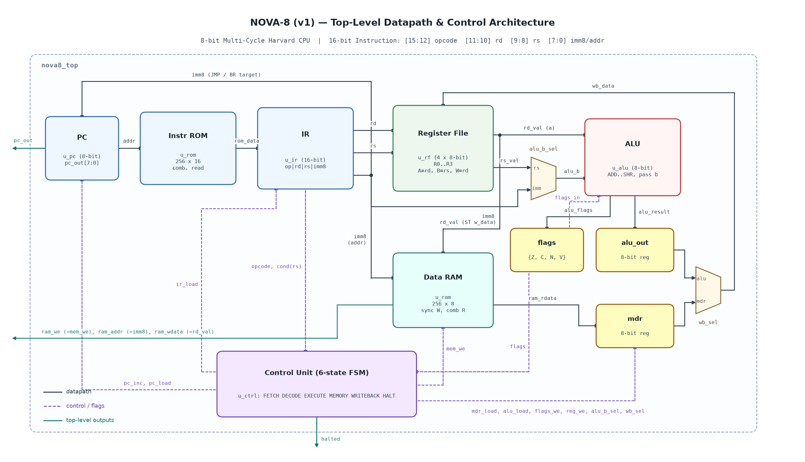
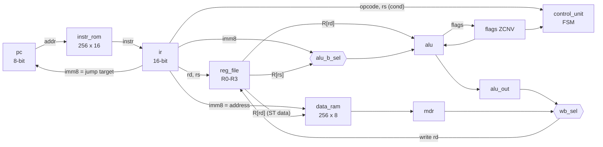
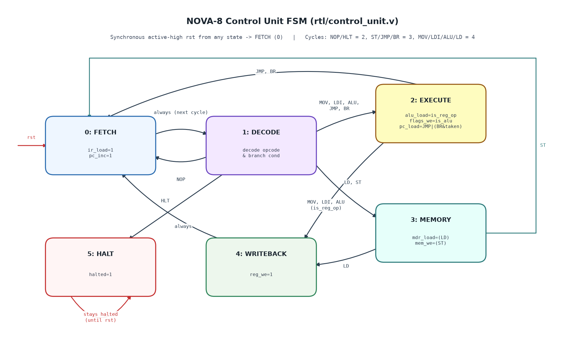
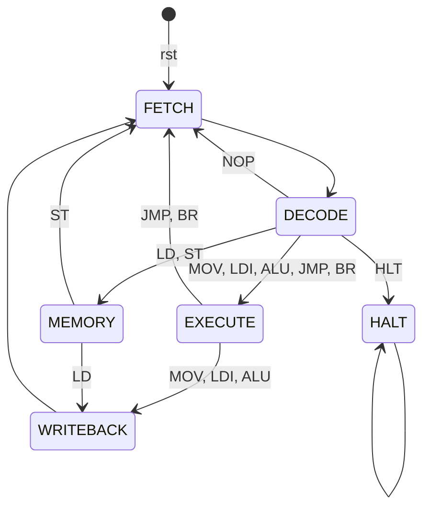

# NOVA-8 architecture (v1)

8-bit, multi-cycle, Harvard CPU. Instructions are 16 bits and live in a
read-only instruction ROM; data lives in a separate 256-byte RAM.

## Block diagram

| Block          | File               | What it does |
|----------------|--------------------|--------------|
| PC             | `rtl/pc.v`         | 8-bit program counter. Increment in FETCH, load imm8 on JMP / taken branch. |
| Instruction ROM| `rtl/instr_rom.v`  | 256 x 16, combinational read, loaded from a hex file with `$readmemh`. |
| IR             | `rtl/ir.v`         | Holds the current instruction and splits it into opcode / rd / rs / imm8. |
| Register file  | `rtl/reg_file.v`   | R0-R3. Port A reads `rd`, port B reads `rs`, write port writes `rd`. |
| ALU            | `rtl/alu.v`        | 8-bit operations and the Z C N V flags. Passes `b` through for MOV/LDI. |
| Data RAM       | `rtl/data_ram.v`   | 256 x 8, synchronous write, combinational read. Address is always imm8. |
| Control unit   | `rtl/control_unit.v` | Multi-cycle FSM that drives every load/write enable. |
| Top level      | `rtl/nova8_top.v`  | Wires everything together, plus the flags, `alu_out` and `mdr` registers and the two muxes. |

Datapath registers inside `nova8_top`:
- `flags` {Z, C, N, V}: written only in EXECUTE of an ALU instruction (ADD to SHR)
- `alu_out`: ALU result, captured in EXECUTE, written to `rd` in WRITEBACK
- `mdr`: memory data register, captured in MEMORY by LD, written to `rd` in WRITEBACK

Muxes:
- `alu_b_sel`: ALU input b is `R[rs]`, or `imm8` for LDI
- `wb_sel`: register write data is `alu_out`, or `mdr` for LD

## Control FSM

The state is 3 bits: FETCH=0, DECODE=1, EXECUTE=2, MEMORY=3, WRITEBACK=4, HALT=5.
Reset (synchronous, active high) always goes back to FETCH with PC = 0.

| State     | Signals asserted                          | Effect |
|-----------|-------------------------------------------|--------|
| FETCH     | `ir_load`, `pc_inc`                       | IR <= ROM[PC], PC <= PC + 1 |
| DECODE    | none                                      | IR fields settle and the next state is chosen from the opcode. Nothing is stored; the register file reads are combinational and their values are used in EXECUTE / MEMORY |
| EXECUTE   | `alu_load` (MOV/LDI/ALU), `flags_we` (ALU only), `pc_load` (JMP, taken BR) | alu_out <= ALU result, flags updated, or PC <= imm8 |
| MEMORY    | `mdr_load` (LD) or `mem_we` (ST)          | mdr <= RAM[imm8], or RAM[imm8] <= R[rd] |
| WRITEBACK | `reg_we`                                  | R[rd] <= alu_out (or mdr for LD) |
| HALT      | none                                      | `halted` = 1, nothing changes until reset |

Because the PC is incremented in FETCH, a branch that is not taken simply
continues at the next instruction; a taken branch overwrites the PC in EXECUTE.

## Cycles per instruction

| Instruction            | States            | Cycles |
|------------------------|-------------------|-------:|
| NOP                    | F D               | 2 |
| MOV, LDI, ALU ops      | F D E W           | 4 |
| LD                     | F D M W           | 4 |
| ST                     | F D M             | 3 |
| JMP, BRx (taken or not)| F D E             | 3 |
| HLT                    | F D, then HALT    | 2 |

Example: `programs/fib.asm` runs in 344 cycles (12 loop passes of 27 cycles,
plus setup and stores).

## Known limits of v1

- Only absolute addresses: there is no pointer register, so loops over arrays
  (like a memory copy) have to be unrolled.
- No CALL/RET or stack.
- No add-with-carry, so 16-bit maths needs branches on C.
- No branch on V (the four branch conditions are Z, C, N and not Z).
- The combinational-read RAM synthesizes to flip-flops and dominates the area
  (see `synth/report.md`).
